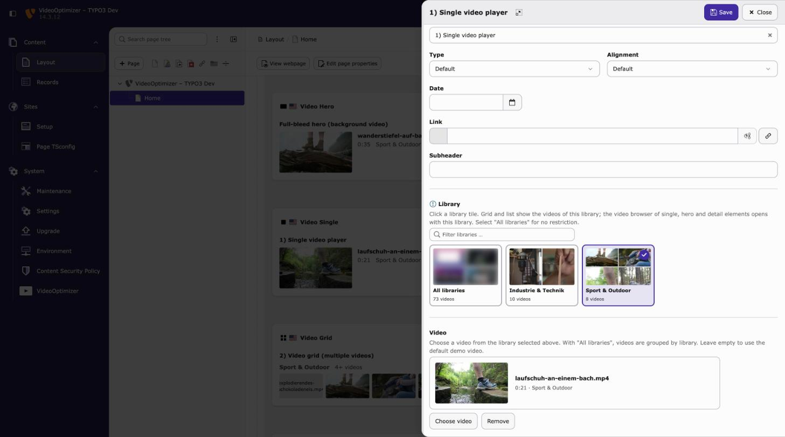
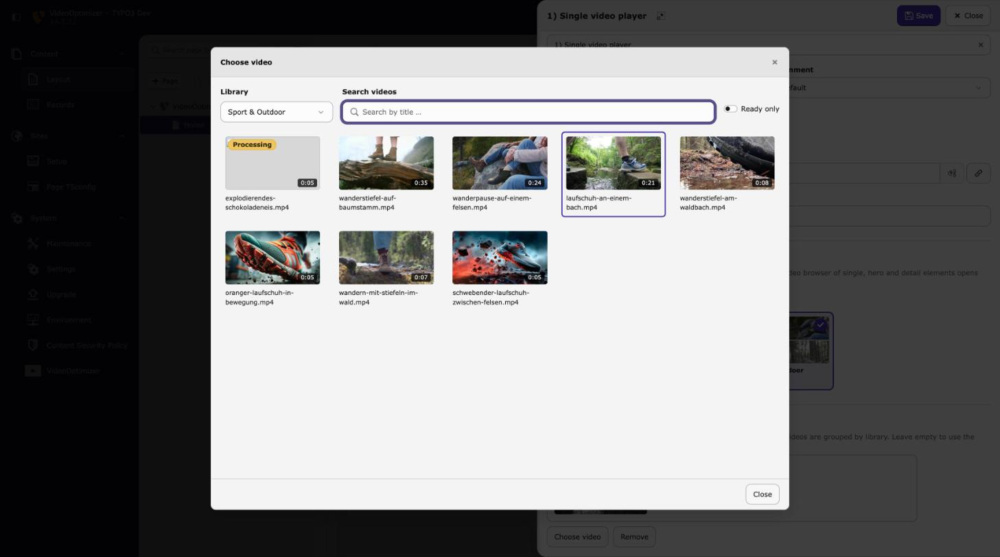
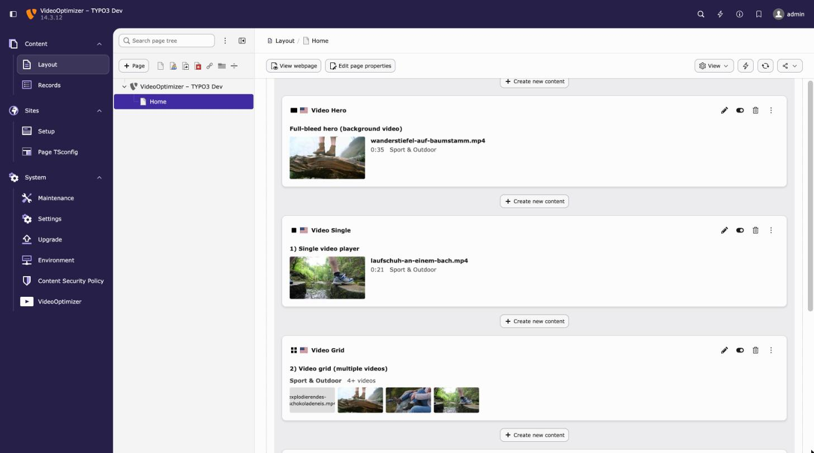
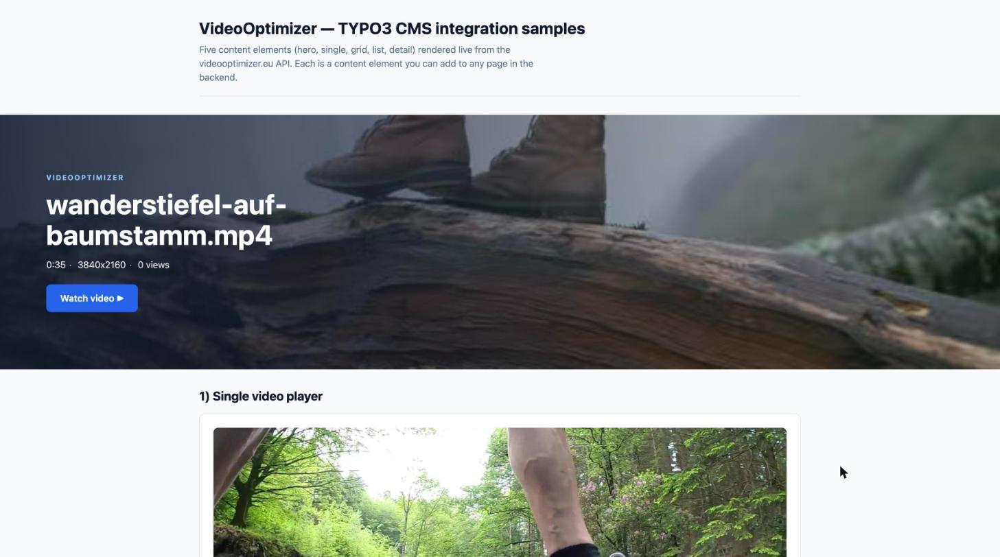
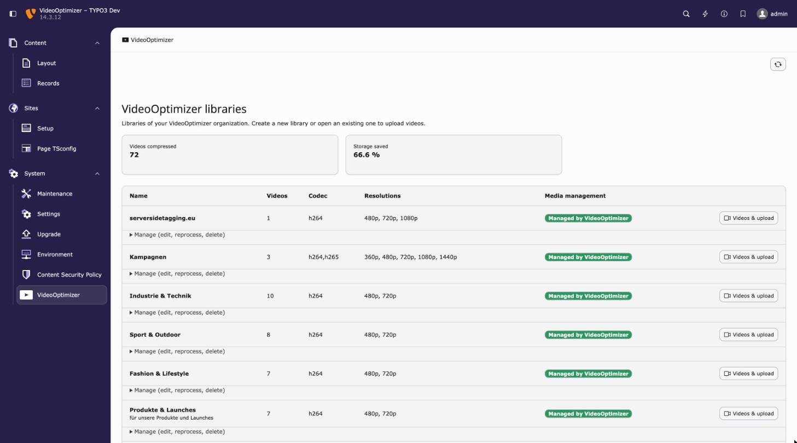

<div align="center">

# 🎬 VideoOptimizer for TYPO3

**Pick, upload and manage CDN-delivered videos — right inside the TYPO3 backend.**

[](https://packagist.org/packages/scalecommerce/videooptimizer-typo3)
[](https://www.php.net/)
[](https://typo3.org/)
[](LICENSE)

[Product](https://videooptimizer.eu/) · [API & docs](https://api.videooptimizer.eu/) · [Report a bug](https://github.com/ScaleCommerce/videooptimizer-typo3/issues)

</div>

---

Give your editors adaptive, CDN-streamed video without ever leaving TYPO3. This extension adds **five
ready-to-use content elements** (hero, single video, grid, list, detail), a **visual library and video
picker**, a **backend module** to manage libraries, videos, thumbnails and subtitles, and **previews in the
page layout** — while the organization's API token stays on the server. Editors just pick a video and
publish.

> Built and maintained by **[ScaleCommerce GmbH](https://scale.sc/)**, the team behind
> [VideoOptimizer](https://videooptimizer.eu/). Part of the `scalecommerce/videooptimizer-<platform>`
> plugin family.

<div align="center">



<sub>Pick a library as a thumbnail tile, then a video from it. <i>(Only some libraries shown; the "All libraries" preview is blurred because it contains people.)</i></sub>

</div>

## ✨ Highlights

- 🧱 **Five content elements** — `Video Hero` (full-bleed background video), `Video Single`, `Video Grid`,
  `Video List` (paginated) and `Video Detail`, in the **Video** group of the new-content-element wizard.
- 🗂️ **Visual pickers** — libraries as thumbnail tiles (with filter and keyboard support), videos in a
  dialog with thumbnail grid, title search and a "ready only" toggle. Library and video stay in sync.
- 🎛️ **Per-element player options** — autoplay, loop, muted, controls, start time, cover fit, subtitle
  language; hero options for eyebrow, subtitle, button (new tab / lightbox / link / none), overlay,
  height and alignment.
- 🛠️ **Backend module** — create, edit, reprocess and delete libraries; upload videos or import them
  from a public `https://` URL; rename, tag and delete videos; pick thumbnails; upload subtitles
  (`.vtt`/`.srt`). Native TYPO3 look, English and German.
- 👀 **Previews in the page layout** (Content → Layout) — every element shows its poster, title, duration,
  library and the options that differ from the defaults.
- 🔎 **SEO built in** — schema.org `VideoObject` / `ItemList` structured data (JSON-LD), one entry per
  video, switchable per site.
- ⚡ **Fast and resilient** — API responses cached with stale-while-error, page-cache tags per video,
  short frontend timeouts; signed **webhooks** (or a schedulable command) refresh exactly the affected
  pages when a video changes.
- 🔐 **Token never touches the browser** — stored in the extension configuration or an environment
  variable; every API call is made server-side.

<details>
<summary><b>Why deliver video through VideoOptimizer's CDN?</b></summary>

Compared to serving `.mp4` files from your own TYPO3 installation or embedding YouTube/Vimeo:

- **Fast, global playback** — cached on edge servers near each viewer, so streams start quickly with
  minimal buffering, worldwide.
- **Adaptive bitrate (HLS)** — every upload is transcoded into a resolution ladder; the player serves the
  right quality for each connection and device.
- **Traffic stays off your server** — the CDN absorbs campaign peaks, and you avoid origin bandwidth
  costs on every view.
- **Your brand, no ads** — no foreign logos, no "up next" suggestions pulling visitors away.
- **Privacy-friendly** — streamed from an EU-based CDN without ad tracking (see
  [Privacy](#-privacy)).
- **Effortless for editors** — upload once; posters, thumbnails and renditions are generated
  automatically.

</details>

<div align="center">



<sub>The video picker: filter by library, search by title, see duration and processing status at a glance.</sub>

</div>

## Requirements

| | |
|---|---|
| TYPO3 | 14.3 LTS, Composer mode |
| PHP | 8.4 or 8.5 |
| Extensions | `fluid_styled_content` (installed as a dependency; the site set builds on it) |
| A VideoOptimizer account | grab an API token (`vp_…`) at [videooptimizer.eu](https://videooptimizer.eu/) → Organization → API tokens |

The token needs the `library:view` permission (the extension lists videos across all libraries). Uploads,
URL import, reprocessing and thumbnail changes require a library that is managed by VideoOptimizer
("media managed"); delivery-only libraries can be browsed and embedded.

## 🚀 Quick start

1. **Install**
   ```bash
   composer require scalecommerce/videooptimizer-typo3
   vendor/bin/typo3 extension:setup
   ```
2. **Add your token.** **System → Settings → Extension Configuration → videooptimizer** → *API token* —
   or set the environment variable `VO_API_TOKEN` (see [Configuration](#configuration)).
3. **Add the site set.** **Sites → Setup**, edit your site, tab *General*, field *Sets for this Site*: add
   **VideoOptimizer content elements** (`scalecommerce/videooptimizer`) and save. Or in
   `config/sites/<site>/config.yaml`:
   ```yaml
   dependencies:
     - scalecommerce/videooptimizer
   ```
4. **Place a video.** In **Content → Layout**, click *Create new content*, choose an element from the
   **Video** group, pick a library and a video, save.
5. **Manage videos.** Open **System → VideoOptimizer** to create libraries, upload videos and maintain
   thumbnails and subtitles.

CSS and the small lightbox script are added automatically by the element templates (only on pages that
use them) — no build step, no TypoScript to include.

<div align="center">



<sub>Previews in Content → Layout: poster, title, duration and library at a glance.</sub>

</div>

## Configuration

**Extension configuration** (System → Settings → Extension Configuration → videooptimizer):

| Setting | Environment variable | Description |
|---|---|---|
| `apiToken` | `VO_API_TOKEN` | Your VideoOptimizer API token (`vp_…`). The extension configuration wins; the environment variable is the fallback. |
| `cacheTtl` | `VO_CACHE_TTL` | Soft TTL in seconds for cached API responses (default `300`). Stale copies are still served for up to 24 h if the API is unreachable. **Here the environment variable wins.** |
| `demoVideoUuid` | `VO_DEMO_VIDEO_UUID` | Fallback video for elements without a selected video. Leave both empty in production. |
| `webhookSecret` | `VO_WEBHOOK_SECRET` | Signing secret of the VideoOptimizer webhook. Empty = webhook receiver disabled. |

> **Production tip:** values from the extension configuration are stored in `config/system/settings.php`.
> For the API token and the webhook secret, prefer the environment variables (`VO_API_TOKEN`,
> `VO_WEBHOOK_SECRET`) so they stay out of files that end up in backups or version control.

**Site setting** (site set `scalecommerce/videooptimizer`):

| Setting | Default | Description |
|---|---|---|
| `videooptimizer.structuredData` | `true` | Output schema.org JSON-LD for the video elements. |

**Cache backend.** API responses live in the `videooptimizer` cache (database backend by default). The
extension only sets it if you haven't, so you can switch to Redis/Valkey in `config/system/additional.php`:

```php
$GLOBALS['TYPO3_CONF_VARS']['SYS']['caching']['cacheConfigurations']['videooptimizer'] = [
    'frontend' => \TYPO3\CMS\Core\Cache\Frontend\VariableFrontend::class,
    'backend' => \TYPO3\CMS\Core\Cache\Backend\RedisBackend::class,
    'options' => ['defaultLifetime' => 86400 /* , Redis connection options */],
    'groups' => ['all'],
];
```

Keep a tag-capable backend — cache invalidation works with tags.

### Permissions

Admins can do everything. For editors, edit their backend user group (`be_groups` record, e.g. via the
*Backend Users* module):

| Tab → field | Grant | Allows |
|---|---|---|
| Module Permissions → *Allowed modules* | **VideoOptimizer** | Open the backend module (read-only without the options below) |
| Module Permissions → *Custom module options* → VideoOptimizer module | **Manage libraries and videos** | Create/edit libraries, rename and tag videos, thumbnails, subtitles |
| | **Upload and ingest videos** | File upload and URL import |
| | **Delete and reprocess** | Delete libraries, videos and subtitles; reprocess a library |
| Record Permissions → *Table permissions* | modify `tt_content` | Use the content elements |
| Record Permissions → *Explicitly allow field values* | the five VideoOptimizer types (only if the group restricts content types) | Insert the content elements |

Every change in the module is a `POST` with a form token; the module never exposes the API token.

Good to know:

- Module access alone allows **reading** (libraries, videos, thumbnails, subtitles); the three custom options
  only gate changes.
- The API token is organization-wide, so the custom options apply to **all** libraries and videos of the
  organization — there is no per-library permission.
- The library/video pickers in content elements are available to admins, users who may modify
  `tt_content`, and users with module access.

## Usage

### Content elements

| Element | What it renders | Video source |
|---|---|---|
| **Video Hero** | Full-bleed section with a muted, looping background video, poster, eyebrow, title, subtitle and a button | one video |
| **Video Single** | A responsive player with title | one video |
| **Video Grid** | A grid of up to 12 videos; click opens a lightbox | a library or all libraries |
| **Video List** | A paginated list (24 per page) with duration and views | a library or all libraries |
| **Video Detail** | Player plus metadata (duration, resolution, views, date) | one video |

- **Library → video.** Pick a library tile first; the video picker then opens with that library. Picking a
  video selects its library tile. Without a video, the element falls back to the configured demo video.
- **Player options** tab: autoplay (muted), loop, muted, controls, start position, cover fit, subtitle
  language.
- **Hero** tab: eyebrow, subtitle override, button label and action (*open player in a new tab* — the
  default —, lightbox, link to a page/URL, or no button), overlay strength, height (compact / default /
  full screen) and text alignment.
- Videos that are still processing (or failed) render a neutral placeholder instead of a broken player.
- **Video List pagination** uses the parameter `tx_videooptimizer_videolist[cursor]`, protected by TYPO3's
  cHash: only links generated by TYPO3 open another page (a wrong cHash ends in a 404, a missing one shows
  page 1). Keep it that way — don't add the parameter to `$GLOBALS['TYPO3_CONF_VARS']['FE']['cacheHash']['excludedParameters']`
  and leave `['FE']['pageNotFoundOnCHashError']` enabled; otherwise anyone could fill the API and page cache
  with arbitrary list pages.

<div align="center">



<sub>The hero element on the demo page (shown with its poster; the background video plays muted behind the text).</sub>

</div>

### Backend module

**System → VideoOptimizer** lists your libraries with video count, codec, resolutions and media management:

- Create a library, edit name, description and encoding ladder, **reprocess** all of its videos, delete it.
- Open a library to **upload** a video file or **import** one from a public `https://` URL (with title,
  tags and metadata), filter by tag, rename/tag/delete videos.
- **Thumbnail**: pick one of the auto-generated frames as poster.
- **Subtitles**: upload or replace `.vtt`/`.srt` tracks per language, delete tracks.

Destructive actions ask for confirmation in a TYPO3 dialog. While videos are encoding, the page refreshes
itself (but not while you're typing).

<div align="center">



<sub>The backend module in TYPO3's native module layout. <i>(Internal test libraries hidden for the screenshot.)</i></sub>

</div>

### Keeping pages up to date

Pages that show videos are cached by TYPO3 like any other page. To refresh them when a video changes
(new title, new poster, finished encoding):

- **Webhook (recommended).** In the VideoOptimizer app, create a webhook under **Organization → Webhooks**
  with the URL `https://<your-site>/videooptimizer/webhook` and put its secret into `webhookSecret`.
  `video.*` events then flush the cached API data and exactly the pages tagged with that video.
- **Polling fallback.** Run the console command periodically — via cron, or with `typo3/cms-scheduler` and its
  task for console commands:
  ```bash
  vendor/bin/typo3 videooptimizer:cache:refresh           # flush pages of changed/removed videos
  vendor/bin/typo3 videooptimizer:cache:refresh --dry-run # only report
  vendor/bin/typo3 videooptimizer:cache:refresh --warm    # also pre-fetch every video
  ```
- Without either, pages refresh on their own: their cache lifetime is capped at `max(cacheTtl, 900 s)`.

### Structured data (SEO)

Hero, single and detail elements output a schema.org `VideoObject` (name, description, thumbnail, upload
date, ISO 8601 duration, embed URL); grid and list output an `ItemList` of the videos shown. A video that
appears several times on a page is described once. Turn it off per site with
`videooptimizer.structuredData: false`.

## Troubleshooting

| Symptom | Cause | Fix |
|---|---|---|
| Elements show nothing on the website | API error, token missing/invalid, or video not found. Visitors never see error details. | Log into the backend (or use the Development context) and reload: the element then shows the reason. Check `var/log/` for `VideoOptimizer` warnings. |
| Element shows "No VideoOptimizer API token configured." (to backend users) | No token in the extension configuration or `VO_API_TOKEN` | Set the token (see [Configuration](#configuration)). |
| Content elements render nothing at all / no styling | The site set is not added to the site | Add **VideoOptimizer content elements** to the site's sets. |
| Library tiles or the video picker show a warning | The API was unreachable or rejected the token when the form loaded | Check the token and its `library:view` permission; the stored selection is kept. |
| Editors can open the module but can't upload or delete | Missing custom module options | Grant the VideoOptimizer options in the editor group (see [Permissions](#permissions)). |
| Upload fails for large files | PHP or web-server upload limits | Raise `upload_max_filesize` / `post_max_size` (and e.g. nginx `client_max_body_size`); the module accepts up to 5 GiB. |
| Webhook answers **503** | No `webhookSecret` configured | Set the secret. |
| Webhook answers **401** | Wrong secret, or the delivery is older than 5 minutes (clock skew) | Copy the secret again; check the server time. |
| A changed video shows up late | No webhook and no refresh command | Set up the webhook or `videooptimizer:cache:refresh`; or flush the caches. |

## Upgrading

```bash
composer update scalecommerce/videooptimizer-typo3
vendor/bin/typo3 extension:setup
vendor/bin/typo3 cache:flush
```

> **Check the [CHANGELOG](CHANGELOG.md)** before upgrading — it lists every notable change and any manual
> follow-up.

## Uninstalling

1. Remove the VideoOptimizer content elements from your pages.
2. Remove the site set **VideoOptimizer content elements** from every site (**Sites → Setup**, field
   *Sets for this Site*, or the `dependencies` in `config/sites/<site>/config.yaml`), so the site
   configuration keeps no reference to a set that no longer exists.
3. Remove the package:
   ```bash
   composer remove scalecommerce/videooptimizer-typo3
   vendor/bin/typo3 cache:flush
   ```

The `vo_*` columns of `tt_content` stay in the database until you remove them via **System → Maintenance →
Analyze Database Structure**.

## 🔐 How it works

The API token is read from the extension configuration (or the environment) and used only on the server:
the frontend controllers, the backend module, the pickers' AJAX endpoints and the webhook receiver all
call the VideoOptimizer REST API through TYPO3's HTTP client (so proxy and TLS settings apply). The
browser only receives video metadata and `https://*.videooptimizer.eu` media URLs; every ID that ends up
in an API path is validated first.

API responses are cached per token in the `videooptimizer` cache with a soft TTL. When a refresh fails,
the last good copy is served for up to 24 hours and the failure itself is cached for 30 seconds, so an
API outage never blocks page rendering (frontend timeouts are 2 s to connect, 8 s overall, with at most
one retry). Rendered pages carry cache tags per video (`vo_video_<uuid>`) and for lists (`vo_lists`), which
the webhook and the refresh command use to flush exactly the affected pages.

## 🔒 Privacy

The extension sets no cookies. The hosted player embedded on your pages sets no cookies and loads no
analytics either (checked in November 2026; it only stores a light/dark display preference in
`localStorage`). As with any embedded media, the visitor's IP address reaches the VideoOptimizer CDN —
mention VideoOptimizer in your privacy policy and conclude a data processing agreement.

## Development

Code style: PSR-12, strict types; backend JavaScript is plain ES modules (no build step), styles are plain
CSS. The extension ships an optional demo site set (`scalecommerce/videooptimizer-demo`) and the console
command `videooptimizer:demo` (Development context only), which place all five elements on the root page.

Automated tests (unit tests for the API client, functional render tests) are planned; until then,
changes are verified manually against a demo installation.

## Contributing

Issues and pull requests are welcome at
[github.com/ScaleCommerce/videooptimizer-typo3](https://github.com/ScaleCommerce/videooptimizer-typo3).

## License

Released under the [MIT License](LICENSE), © ScaleCommerce GmbH.
